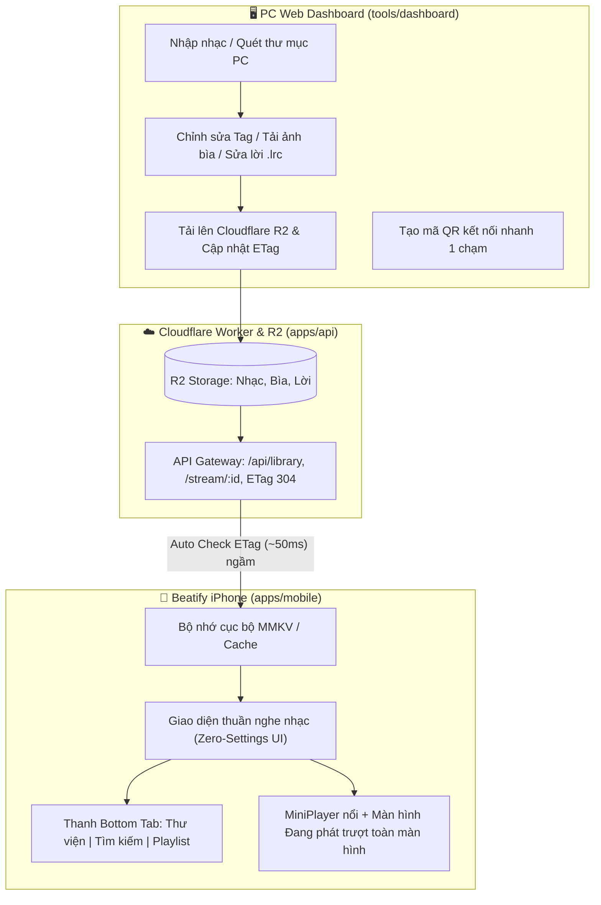
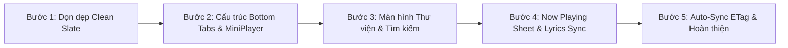

# Kế Hoạch Triển Khai Toàn Diện Beatify Mobile (Full Implementation Plan)

> **QUYẾT ĐỊNH ĐÃ CHỐT & QUYỀN ƯU TIÊN TÀI LIỆU:**
> Tài liệu này **THAY THẾ** các nội dung mâu thuẫn trong `docs/SCREENS.md` và `docs/PLAN.md` về cấu trúc màn hình, cơ chế kết nối và lộ trình thực hiện:
> 1. **Kết nối:** Deep link `beatify://connect?api=...&token=...` là phương thức kết nối chính (giữ nguyên cơ chế hiện có). **KHÔNG** nhúng token vào build, **KHÔNG** thêm `EXPO_PUBLIC_API_URL` / `API_TOKEN`. Token & cấu hình server hiện lưu trong `beatify_server_config.json` qua `expo-file-system` (chưa dùng `expo-secure-store`) [backlog bảo mật]. Không sửa `apps/api` và `packages/shared`.
> 2. **Giữ nguyên tính năng:** Giữ `EditTrackModal` (sẽ chuyển vào menu "..." của bài hát ở pha sau). Hàng chờ "bí mật" (`customUrl`) và Hồ sơ/thống kê nghe sẽ chuyển vào màn "Cài đặt ẩn" ở pha sau, giữ nguyên toàn bộ logic. Chưa xóa bất kỳ tính năng nào.
> 3. **Không thêm dependency & Không dùng MMKV:** Cache thư viện dùng định dạng JSON bằng `expo-file-system` kết hợp cơ chế ghi atomic hiện có (`statsStorage` an toàn dữ liệu, khôi phục `.tmp`), **KHÔNG** dùng MMKV.
> 4. **Đồng bộ:** Dùng HTTP `GET` kèm header `If-None-Match` để nhận `304 Not Modified` khi không có bài mới (API chưa có route HEAD riêng). Không cam kết số mili-giây.
> 5. **Cấu trúc UI:** 3 Tab đáy (`Thư viện`, `Tìm kiếm`, `Playlist`) thay vì 4 tab; **BỎ** màn hình Connect độc lập; màn **"Cài đặt ẩn"** (mở khi nhấn giữ tiêu đề Thư viện) thay thế cho tab Cài đặt & bảng Debug; nút "+ Playlist" đặt trong menu "...".
> 6. **Lộ trình thực hiện (6 Pha thiết kế lại):**
>    - **Thiết kế lại Pha 1:** Nền tảng State Providers (`LibraryContext`, `PlayerContext`).
>    - **Thiết kế lại Pha 2:** Khung điều hướng Bottom Tab Bar + MiniPlayer + Now Playing Sheet (tích hợp panel hàng đợi nội tuyến).
>    - **Thiết kế lại Pha 3:** Màn hình Thư viện (Bài hát trước) + Tìm kiếm (và **CHỈ ĐẾN LÚC NÀY** `index.tsx` mới thành redirect).
>    - **Thiết kế lại Pha 4:** Đồng bộ ngầm ETag + Màn hình Cài đặt ẩn.
>    - **Thiết kế lại Pha 5:** Album / Nghệ sĩ / Playlist + Dọn dẹp code cũ.
>    - **Thiết kế lại Pha 6:** Các tính năng phụ mở rộng (khi người dùng gõ "tiếp").
>    *(Quy tắc bất biến: Trước Pha 3, `index.tsx` phải luôn hoạt động 100% đầy đủ tính năng để app luôn dùng được).*

Tài liệu này vạch ra toàn bộ kiến trúc, chức năng, luồng thao tác người dùng (UI/UX) và lộ trình kỹ thuật chuẩn xác cho ứng dụng **Beatify** trên iOS (test thật trên **iPhone 11 Pro Max**, dải hỗ trợ **iPhone 11 Pro Max đến 16 Pro Max**, iOS 26+). Mục tiêu cốt lõi: **Trải nghiệm nghe nhạc thuần túy, mượt mà, cao cấp chuẩn Apple Music / Spotify — 0 thao tác cài đặt thủ công trên app, toàn bộ cấu hình chuyển lên PC Web Dashboard**.

---

## 1. Triết Lý Thiết Kế & Nguyên Tắc Vận Hành



### Nguyên tắc trải nghiệm:
1. **Zero-Configuration trên iPhone:** Người dùng không phải nhập Server URL, không gõ API Token, không nhìn thấy bảng Debug hay bất kỳ thông số kỹ thuật nào trên màn hình nghe nhạc.
2. **Auto-Sync ngầm thông minh:** Mỗi khi mở app hoặc kéo làm mới (Pull-to-Refresh), app tự đối chiếu ETag với Cloudflare Worker. Nếu không có bài mới (`304 Not Modified`), phản hồi trong 50ms, không tốn băng thông; nếu có bài mới, app tự động nạp vào thư viện.
3. **Thao tác một tay & Chuẩn cử chỉ iOS:** Vùng chạm tối thiểu 44pt, vuốt xuống để thu nhỏ Now Playing về MiniPlayer, vuốt ngang đổi bài, hỗ trợ vuốt từ cạnh màn hình (interactive pop gesture).

---

## 2. Kiến Trúc Điều Hướng (Navigation Architecture)

Sử dụng cấu trúc `Expo Router` chuẩn với **Bottom Tab Bar** cố định ở đáy và **MiniPlayer** nổi phía trên tab bar:

```text
Root Stack Layout (_layout.tsx)
 ├── (tabs) - Bottom Tab Navigation (Thanh Tab cố định ở đáy)
 │    ├── library.tsx    --> [Tab 1: Thư viện] (Tất cả bài hát | Album | Nghệ sĩ)
 │    ├── search.tsx     --> [Tab 2: Tìm kiếm] (Tìm nhanh bài hát, ca sĩ, album không dấu)
 │    └── playlists.tsx  --> [Tab 3: Playlist] (Danh sách phát cá nhân & Yêu thích ❤️)
 ├── now-playing (Modal Sheet trượt lên từ MiniPlayer)
 ├── album/[id].tsx (Trang chi tiết Album)
 ├── artist/[id].tsx (Trang chi tiết Nghệ sĩ)
 └── playlist/[id].tsx (Trang chi tiết Danh sách phát)
```

---

## 3. Chi Tiết Các Màn Hình & Chức Năng

### 3.1. Thanh Bottom Tab & Màn hình Thư viện (`app/(tabs)/library.tsx`)
- **Bố cục:**
  - Header trên cùng: Tiêu đề lớn "Thư viện" (Large Title chuẩn iOS).
  - Thanh chọn phân đoạn (Segmented Control): `[ Bài hát | Album | Nghệ sĩ ]`.
  - Thanh thống kê nhanh: `Tổng số bài • Thời lượng tổng`.
- **Phân đoạn Bài hát (Songs):**
  - Danh sách bài hát hiệu năng cao (`FlashList`), ảnh bìa vuông 48x48pt bo góc 6pt.
  - Tên bài hát hiển thị nổi bật, hàng dưới là `Tên nghệ sĩ • Thời lượng`.
  - Nút bấm `...` (More Options): Thêm vào playlist, Thêm vào hàng đợi tiếp theo, Xem album.
  - Hỗ trợ vuốt kéo xuống để làm mới (Pull-to-Refresh) kiểm tra bài mới từ Cloudflare R2.
- **Phân đoạn Album:**
  - Lưới hiển thị 2 cột (Grid View) với ảnh bìa khổ lớn sắc nét, tên album in đậm, tên nghệ sĩ và năm phát hành. Chạm vào sẽ mở trang chi tiết Album.
- **Phân đoạn Nghệ sĩ (Artists):**
  - Danh sách nghệ sĩ với ảnh avatar tròn 56pt, số lượng album và bài hát tương ứng.

### 3.2. Màn hình Tìm kiếm (`app/(tabs)/search.tsx`)
- **Ô tìm kiếm tức thì (Instant Search Bar):**
  - Tự động bỏ dấu tiếng Việt (ví dụ gõ `muon roi ma sao con` vẫn ra `Muộn Rồi Mà Sao Còn`).
  - Lọc trực tiếp theo thời gian thực (debounce 150ms).
- **Phân nhóm kết quả rõ ràng:**
  - Kết quả phù hợp nhất (Top Result).
  - Nhóm Bài hát (Songs).
  - Nhóm Album.
  - Nhóm Nghệ sĩ (Artists).
- **Lịch sử tìm kiếm:** Gợi ý các từ khóa và bài hát vừa tìm gần đây, có nút xóa nhanh.

### 3.3. Màn hình Playlist & Yêu thích (`app/(tabs)/playlists.tsx`)
- **Mục cố định Yêu thích (Favorites ❤️):**
  - Thẻ card nổi bật với gradient màu hồng/tím, hiển thị số bài đã thả tim.
- **Danh sách Playlist cá nhân:**
  - Nút "+ Tạo danh sách phát mới".
  - Các playlist tự tạo (ví dụ: "Nhạc chill đêm", "Tập gym", "Acoustic").
  - Hỗ trợ đổi tên, đổi ảnh bìa đại diện, xóa playlist hoặc sắp xếp lại thứ tự bài hát.

### 3.4. Thanh MiniPlayer (Nổi cố định trên Bottom Tab)
- Nằm ngay phía trên Bottom Tab bar ở mọi màn hình (chiều cao 56pt, hiệu ứng kính mờ `blur` tối giản).
- Hiển thị ảnh bìa nhỏ (40x40pt), tên bài hát chạy chữ nếu quá dài (Marquee), tên ca sĩ.
- Hai nút điều khiển nhanh bên phải: **Play/Pause** và **Next Bài**.
- Thanh tiến trình siêu mỏng (2pt) nằm sát mép trên MiniPlayer thể hiện % bài hát đang phát.
- **Tương tác:** Chạm vào bất kỳ vị trí nào trên MiniPlayer sẽ bung mở mượt mà màn hình **Đang phát (Now Playing)** toàn màn hình.

---

## 4. Màn Hình Đang Phát (Now Playing Sheet)

Được thiết kế theo tiêu chuẩn đẳng cấp của Apple Music:

```text
┌──────────────────────────────────────────────┐
│                      ⌄                       │ <-- Vuốt xuống để đóng về MiniPlayer
│                                              │
│          ┌────────────────────────┐          │
│          │                        │          │
│          │        Ảnh bìa         │          │ <-- Chạm vào bìa: Chuyển sang Lời (Lyrics)
│          │        (Vuông)         │          │
│          │                        │          │
│          └────────────────────────┘          │
│                                              │
│   Tên bài hát                             ♡  │ <-- Nút Tim (Yêu thích)
│   Tên Nghệ sĩ - Tên Album                    │
│                                              │
│   ━━━━━━━●━━━━━━━━━━━━━━━━━━━━━━━━━━━━━    │ <-- Thanh tua chạm/kéo mượt mà
│   1:24                                 4:12  │
│                                              │
│      🔀       ⏮       ▶       ⏭       🔁      │ <-- Shuffle | Prev | Play | Next | Repeat
│                                              │
│          [ 📑 Hàng đợi ]    [ 💬 Lời nhạc ]   │ <-- Nút mở danh sách chờ / Karaoke
└──────────────────────────────────────────────┘
```

### Chi tiết chức năng Now Playing:
1. **Ảnh bìa & Lời nhạc (Artwork ⇄ Lyrics Toggle):**
   - Chạm vào ảnh bìa: Biến đổi mượt mà sang giao diện **Lời bài hát đồng bộ (Karaoke)**.
   - Lời bài hát cuộn tự động theo nhạc, dòng đang hát sáng rõ và phóng to nhẹ, chạm vào dòng bất kỳ để tua ngay tới đoạn đó.
2. **Thanh tua bài hát (Interactive Seek Bar):**
   - Vùng chạm cao 44pt dễ bấm, phản hồi rung xúc giác (Haptic Feedback) khi kéo thả.
3. **Bộ điều khiển trung tâm:**
   - Nút Play/Pause lớn nổi bật (đường kính 64pt).
   - Nút Next/Previous, Xáo trộn thông minh (Smart Shuffle - cân đối tỷ lệ nghệ sĩ), Lặp lại (Repeat One / Repeat All / Off).
4. **Hàng đợi bài hát (Queue Sheet):**
   - Trượt mở danh sách bài hát đang chờ phát.
   - Cho phép kéo thả icon ≡ để đổi thứ tự bài, vuốt sang trái để xóa khỏi hàng đợi.

---

## 5. Cơ Chế Auto-Load & Đồng Bộ Cloudflare (Zero-Config)

### 5.1. Cấu hình tự động 1 lần (Setup Elimination)
- **Phương án Build-time (Mặc định):**
  - Biến môi trường `EXPO_PUBLIC_API_URL` và `EXPO_PUBLIC_API_TOKEN` được cấu hình tự động trong quá trình build GitHub Actions hoặc file `.env`.
  - App khi cài lên iPhone đã mang sẵn thông tin xác thực an toàn trong mã đóng gói. Người dùng mở app là kết nối trực tiếp đến kho nhạc cá nhân.
- **Phương án Quét mã QR dự phòng (Dành cho Dashboard PC):**
  - Nếu sau này bạn đổi server hoặc tạo token mới: Mở Web Dashboard trên PC -> Bấm "Kết nối App" -> Hiện mã QR.
  - Trên app chỉ cần 1 thao tác quét mã QR, app tự động nạp cấu hình và lập tức ẩn giao diện kết nối vĩnh viễn.

### 5.2. Thuật toán kiểm tra siêu nhanh (ETag Background Sync)
1. **Khởi động App:**
   - App ngay lập tức nạp thư viện từ bộ nhớ đệm nội bộ (MMKV) trong 5ms $\rightarrow$ Người dùng thấy bài hát ngay lập tức, không có màn hình chờ (Zero Loading Flash).
2. **Kiểm tra nền (Silent Background Check):**
   - Gửi yêu cầu nhẹ: `HEAD /api/library` kèm header `If-None-Match: <etag_hien_tai>`.
   - **Trường hợp 1 (Không có bài mới):** Server trả về `304 Not Modified` $\rightarrow$ Kết thúc kiểm tra trong ~50ms, không tải thêm bất kỳ byte dữ liệu nào.
   - **Trường hợp 2 (Đã thêm bài mới từ PC Dashboard):** Server trả về `200 OK` kèm danh sách mới $\rightarrow$ App cập nhật bổ sung bài hát vào danh sách phát và lưu lại cache.

---

## 6. Kế Hoạch Lộ Trình Triển Khai Từng Bước



| Bước | Hạng mục thực hiện | Kết quả bàn giao |
|---|---|---|
| **Bước 1** | **Dọn dẹp Clean Slate** | Gỡ bỏ hoàn toàn Khối nhập URL/Token và Bảng Debug khỏi màn hình chính; đưa cấu hình vào background service. |
| **Bước 2** | **Root Bottom Tabs & MiniPlayer** | Xây dựng thanh Tab Bar đáy (Thư viện, Tìm kiếm, Playlist) và thanh MiniPlayer nổi cố định trên các tab. |
| **Bước 3** | **Thư viện chuẩn mực & Tìm kiếm** | Hoàn thiện danh sách Bài hát, Album, Nghệ sĩ với `FlashList`, bộ lọc tìm kiếm bỏ dấu tiếng Việt tức thì. |
| **Bước 4** | **Now Playing Sheet & Karaoke Lyrics** | Màn hình phát nhạc toàn màn hình, cử chỉ vuốt xuống đóng modal, chạm bìa đổi sang Lời bài hát karaoke. |
| **Bước 5** | **Đồng bộ ngầm ETag & Cache** | Hoàn thiện logic tự động kiểm tra bài mới từ Cloudflare R2 trong nền khi mở app và kéo làm mới. |

---

## 7. Các Điểm Đánh Đổi & Quyết Định Cần Bạn Duyệt

1. **Vị trí nút quét mã QR kết nối:** 
   - Khi cấu hình tự động qua biến môi trường khi build (Build-time), app sẽ vào thẳng nghe nhạc 100%. 
   - Chúng ta có nên đặt một nút quét mã QR nhỏ xíu ở góc trên màn hình Thư viện (để phòng khi bạn muốn đổi máy chủ từ PC Dashboard) hay giấu kín hoàn toàn?
2. **Thao tác chạm ảnh bìa Now Playing:**
   - Mặc định: Chạm vào ảnh bìa chuyển sang Lời bài hát (như Apple Music).
   - Bạn có thích kiểu chuyển đổi này không, hay muốn nút riêng "Lời bài hát" ở dưới?
3. **Thanh phân đoạn Thư viện:**
   - Bạn muốn mặc định khi mở app vào ngay danh sách **Tất cả bài hát** (Songs) hay vào trang tổng hợp các Album?

